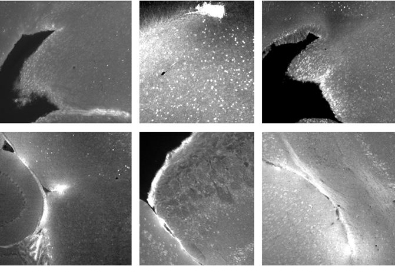
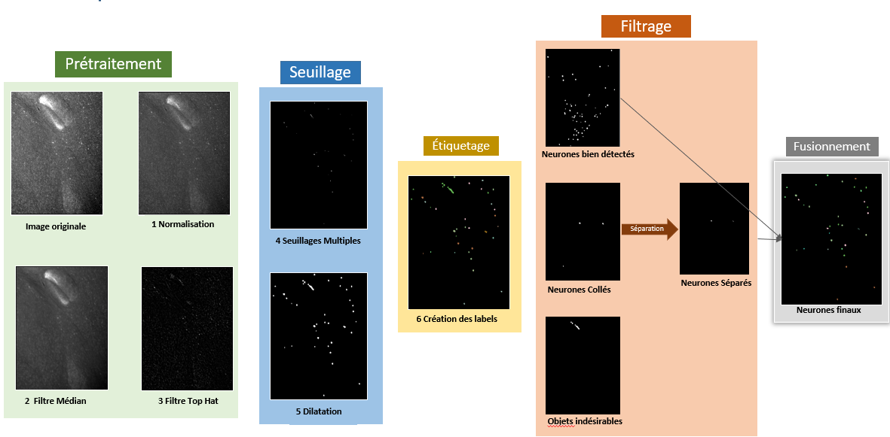
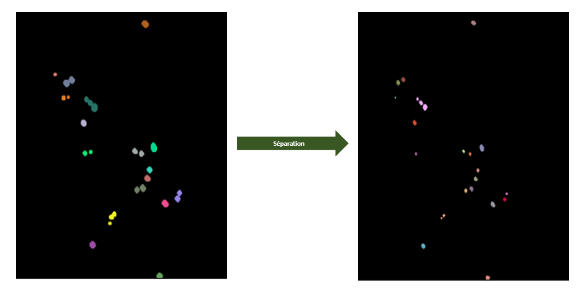
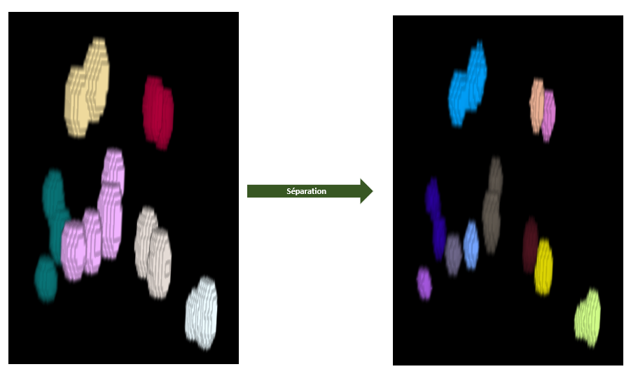
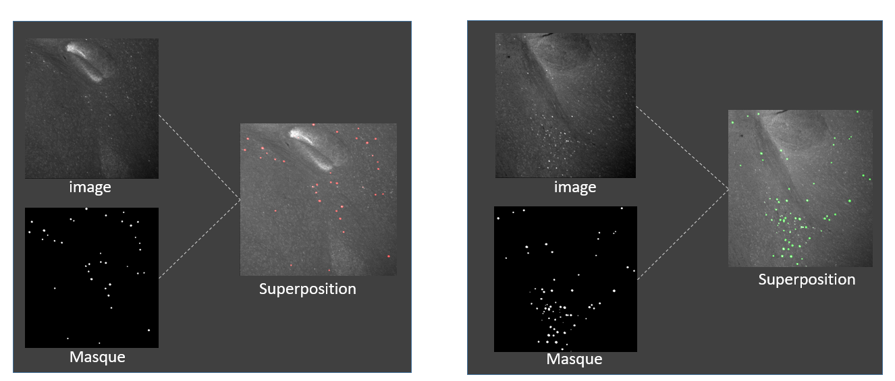

# Classical 3D Image Processing Pipeline for c-Fos+ Neuron Detection and Quantification

## Table of Contents

- [Overview](#overview)
- [Problem Statement and Goal](#problem-statement-and-goal)
- [Data](#data)
- [Methodology](#methodology)
  - [Pipeline Overview](#pipeline-overview)
  - [Phase 1 — Preprocessing](#phase-1--preprocessing)
  - [Phase 2 — Segmentation](#phase-2--segmentation)
  - [Phase 3 — Post-processing and Filtering](#phase-3--post-processing-and-filtering)
  - [Statistics Extraction and Export](#statistics-extraction-and-export)
- [Results](#results)

---

## Overview

This project provides a **fully interpretable, parameter-driven pipeline** for detecting and quantifying **c-Fos+ neurons** in 3D mouse brain images. Unlike deep learning–based approaches, the pipeline requires **no annotated training data** and relies exclusively on **morphological image processing** and **SimpleITK**.

The pipeline is organized in **three phases** — preprocessing, segmentation, and post-processing — for a total of **11 sequential steps**, from the raw 3D volume to a final CSV file containing per-neuron morphological statistics. Each parameter (kernel size, threshold, sphericity, elongation, etc.) is exposed and adjustable, making the pipeline **transparent, reproducible, and easy to tune** to new acquisition conditions.

---

## Problem Statement and Goal

The expression of the immediate early gene **c-Fos** is a widely used marker of neuronal activity. Following a stimulus, activated neurons express the c-Fos protein, which appears as **bright fluorescent spots** in 3D microscopy images. Accurately detecting and counting these neurons is essential for quantifying brain activation patterns.

However, automated quantification from raw 3D volumes faces several challenges:

1. **Inhomogeneous background** — tissue autofluorescence and uneven illumination create bright regions that cannot be separated from neurons by a simple global threshold.
2. **Z-slice intensity drift** — light scattering through the sample makes slices at different depths inconsistently bright.
3. **Impulse noise** — isolated very bright or very dark voxels.
4. **Touching neurons** — several neurons can merge into a single connected component and must be separated to be counted individually.
5. **Undesirable structures** — blood vessels and artifacts also appear as bright fluorescent structures and can be mistaken for neurons.

**Goal:** Build an automated, interpretable, and reproducible pipeline that:

- normalizes and denoises the raw 3D volume,
- segments bright structures in a background-independent way,
- filters out vessels and artifacts using morphological features,
- separates touching neurons to count them accurately,
- exports per-neuron statistics for downstream biological analysis.

---

## Data

The pipeline operates on **3D volumetric images** (Z-stacks) of mouse brain acquired with a **Zeiss Lightsheet 7** microscope.

A 3D image is a volumetric dataset in which each voxel has three spatial coordinates `(x, y, z)` and an intensity value. The volume is stored as a stack of optical sections and can be analyzed in depth, unlike 2D images.

| Parameter                       | Value                      |
| ------------------------------- | -------------------------- |
| Microscope                      | Zeiss Lightsheet 7         |
| Image type                      | 3D volumetric (Z-stack)    |
| File format                     | NRRD (converted from CZI)  |
| Bit depth                       | 16 bits                    |
| Resolution (after downsampling) | 2.5 µm × 2.5 µm × 4.683 µm |
| Channel of interest             | c-Fos                      |

The pipeline was designed to handle volumes containing hundreds of millions of voxels and to produce results in a reasonable time on a standard workstation.

### Structure Diversity in Raw 3D Images

A raw 3D volume is **not limited to c-Fos+ neurons**: it contains a heterogeneous mix of fluorescent structures that vary in shape, intensity, and spatial organization. Four main types of structures are observed:

- **c-Fos+ neurons** — small, roughly **round** objects (typically 5–15 voxels in diameter). They are the target of the pipeline. Their signal is well-defined, with a bright core and a gradually fading border.
- **Blood vessels** — **elongated, tubular** structures that can span a large part of the volume. Their intensity is often similar to that of neurons, and their geometry is highly variable (straight segments, bifurcations, tortuous paths).
- **Artifacts** — bright spots caused by **tissue autofluorescence**, dust, or imaging imperfections. They can appear as **isolated bright blobs**, **irregular clumps**, or **thin bright streaks**, and their intensity and shape vary widely from one acquisition to another.
- **Diffuse background** — a low-intensity, **inhomogeneous** signal produced by out-of-focus fluorescence and tissue scattering. It is not a structure per se, but it heavily affects the dynamic range of the image and complicates the choice of a global threshold.

Because vessels and artifacts **share intensity levels with neurons**, a purely intensity-based approach cannot reliably separate them. This is precisely why the pipeline combines **background removal (top-hat)**, **intensity interval thresholding**, and **morphological classification** (size, sphericity, elongation, density) — to discriminate true neurons from other bright structures based not only on their brightness but also on their **shape** and **compactness**.

_Figure — Diversity of structures observed in raw 3D images. Neurons appear as small round bright spots, blood vessels as elongated tubular structures, and artifacts as irregular bright clumps. All of them share similar intensity levels, which is why a purely intensity-based threshold is insufficient._

---

## Methodology

### Pipeline Overview

The pipeline is composed of **11 steps** organized into **three phases**:

1. **Preprocessing** — normalize and enhance the image (steps 1–3).
2. **Segmentation** — extract bright structures as connected components (steps 4–6).
3. **Post-processing and filtering** — classify, separate, and quantify neurons (steps 7–11).

_Figure 1 — Complete classical quantification pipeline. The image is processed in three phases: preprocessing, segmentation, and post-processing._

---

### Phase 1 — Preprocessing

#### Step 1 — Z-slice normalization

Light scattering through the 3D sample produces **inhomogeneous intensity levels across Z-slices** of the same stack. To balance brightness, each slice is normalized by its own mean intensity.

For each slice $i$, compute the mean intensity:

$$
\mu_i = \frac{1}{N_x N_y} \sum_{x=1}^{N_x} \sum_{y=1}^{N_y} I_i(x,y)
$$

Then compute the median of all slice means:

$$
\mu_{\text{med}} = \mathrm{median}\left(\{\mu_1, \mu_2, \ldots, \mu_{N_z}\}\right)
$$

And apply a per-slice correction factor:

$$
I_i^{\text{norm}}(x,y) = I_i(x,y) \times \frac{\mu_{\text{med}}}{\mu_i}
$$

After this step, all slices share the same mean intensity, so neurons are comparable from slice to slice.

#### Step 2 — 3D median filter

The raw images contain **impulse noise**: isolated very bright or very dark voxels. A **3D median filter** is applied to suppress this noise **without deforming neurons**.

For each voxel `(x, y, z)`, a cubic neighborhood of **radius r = 2** (i.e. a 5 × 5 × 5 voxel cube) is considered. The voxel values in this neighborhood are sorted and the central voxel is replaced by the **median** of the list.

The median was chosen over the mean because it is **robust to extreme values**: a single very bright voxel does not pull the value upward.

#### Step 3 — 3D white top-hat

Because the background is **not uniform** (tissue autofluorescence, illumination variations), a simple global threshold is poorly adapted. The **white top-hat** transform is used to **remove the background** and highlight bright structures.

$$
\mathrm{TopHat}(I) = I - \gamma(I)
$$

where $\gamma(I)$ is the **morphological opening** (erosion followed by dilation):

$$
\gamma(I) = (I \ominus B) \oplus B
$$

The structuring element $B$ is an **ellipsoid of radius [4, 4, 2]**. A smaller radius in Z accounts for the lower axial resolution. The opening removes structures smaller than the structuring element; the subtraction reveals bright structures on a **homogenized background**.

---

### Phase 2 — Segmentation

#### Step 4 — Intensity thresholding

After top-hat, the grayscale image is converted to a **binary mask** using an **intensity interval threshold**:

$$
I_{\text{binary}}(x,y,z) =
\begin{cases}
1 & \text{if } T_{\min} \leq I_{\text{top}}(x,y,z) \leq T_{\max} \\
0 & \text{otherwise}
\end{cases}
$$

The thresholds used are $T_{\min} = 70$ and $T_{\max} = 330$, measured experimentally on the data: c-Fos+ neurons have intensities in this range. The lower bound removes background, the upper bound removes over-bright artifacts.

#### Step 5 — Binary dilation

Thresholding **erodes neuron borders** because they are less bright than the center. A **binary dilation** with a **spherical structuring element of radius [3, 3, 1]** restores a size closer to the true fluorescent contour.

$$
A \oplus B = \{ z \in \mathbb{Z}^3 \mid (B_z \cap A) \neq \emptyset \}
$$

In practice, each white voxel is expanded by 3 voxels in X/Y and 1 voxel in Z.

#### Step 6 — Connected components

Each connected object in the binary mask is assigned a **unique label**, using **26-connectivity** (two voxels are connected if they touch, including diagonally). The output is a labeled image where each neuron (or artifact) has its own ID.

---

### Phase 3 — Post-processing and Filtering

#### Step 7 — Morphological classification

Each labeled object is characterized using `sitk.LabelShapeStatisticsImageFilter` from **SimpleITK**, which computes:

| Feature        | Formula                                                                    | Meaning                                     |
| -------------- | -------------------------------------------------------------------------- | ------------------------------------------- |
| **Volume**     | $V = \sum_{(x,y,z)\in\text{label}} 1$                                      | Number of voxels                            |
| **Sphericity** | $S = 1 / \text{flatness}$                                                  | Close to 1 for round objects                |
| **Elongation** | $E = \lambda_1 / \lambda_3$                                                | Ratio of longest to shortest principal axis |
| **Flatness**   | $F = \lambda_2 / \lambda_3$                                                | Ratio of middle to shortest principal axis  |
| **Density**    | $\rho = V / (X_{\text{bbox}} \cdot Y_{\text{bbox}} \cdot Z_{\text{bbox}})$ | Fill ratio of the bounding box              |

The elongation, flatness, and sphericity are computed from the **principal axes** of the object (obtained by **PCA**). These axes are **independent of the object's orientation in the image** — they are not the X/Y/Z image axes, nor the bounding-box dimensions.

#### Step 8 — Distance-map-based separation

Objects classified as **touching neurons** contain several neurons fused into a single connected component. They are separated using a **distance map**.

For a binary object $A$, the distance map $D(x,y,z)$ is defined as the **minimum Euclidean distance** between a voxel and the boundary of the object:

$$
D(x,y,z) = \min_{(x', y', z') \in \partial A} \| (x, y, z) - (x', y', z') \|_2
$$

where $\partial A$ is the boundary of the object. The distance map transforms the object into a **relief**: neuron centers become **peaks** (maximum values) and contact zones become **valleys** (minimum values).

The distance map is computed with the **Danielsson algorithm** (`SignedDanielssonDistanceMapImageFilter`), more precise than Maurer for very close objects. Thresholding the distance map between `lower = 2` and `upper = 3` isolates the **central regions of each neuron** while excluding contact zones.

The distance-map approach reaches a **separation rate of 1.86**, meaning each "touching neuron" object contains **1.86 neurons on average**. This is higher than the Maurer algorithm (1.50), confirming Danielsson's superiority for this data. This rate is considered satisfying because it reflects **biological reality**: some objects classified as `neuron_multi` actually contain only one neuron and should not be split.

After extracting connected components of the thresholded regions, a binary dilation of radius 1 is applied to restore the original neuron size. The dilated regions are then **masked by the original object** to avoid overflowing its boundary.

_Figure 2 — Touching-neuron separation in a 2D slice. Left: before separation. Right: after separation._

_Figure 3 — 3D visualization of the same separation._

#### Step 9 — Fusion

Isolated neurons and separated neurons are merged into a **single labeled image**. If $L_{\text{iso}}$ is the isolated-neuron image (labels 1 to $N$) and $L_{\text{sep}}$ is the separated-neuron image (labels 1 to $M$), the labels of the separated image are shifted:

$$
L_{\text{sep}}'(x,y,z) = L_{\text{sep}}(x,y,z) + N
$$

And the two images are merged **pixel-wise by maximum**:

$$
L_{\text{final}}(x,y,z) = \max\left(L_{\text{iso}}(x,y,z),\ L_{\text{sep}}'(x,y,z)\right)
$$

This is valid because the two images do not overlap spatially.

---

### Statistics Extraction and Export

At the end of the pipeline, **isolated neurons** and **separated neurons** are merged into a **single final labeled image**. Objects classified as **vessels or artifacts** are saved separately.

For each detected neuron, the following features are extracted:

- **size** (voxel count),
- **sphericity**,
- **elongation**,
- **flatness**,
- **bounding-box dimensions**.

These measurements are exported to a **CSV file per sample**, together with:

- the **fused neuron image** (final result),
- the **removed-object image**,
- the **touching-neuron image before separation**.

The **total neuron count** is simply the **last label** in the fused-neuron features file — a direct, reproducible quantification per sample.

---

## Results

The pipeline was applied to 3D c-Fos images. It correctly handles the three major difficulties of the raw data:

1. **Inhomogeneous background** — corrected by Z-slice normalization and 3D top-hat.
2. **Impulse noise** — removed by the 3D median filter.
3. **Touching neurons** — separated by the distance-map approach, with a **separation rate of 1.86** (better than Maurer's 1.50).
4. **Vessels and artifacts** — filtered out using morphological criteria (size, elongation, sphericity, density).

_Figure 4 — Final result of the full pipeline: only true c-Fos+ neurons remain in the fused image._

The pipeline was designed so that **every step is parameterized and logged**, allowing users to adapt it to new acquisition conditions by editing a single configuration file, without touching the source code.